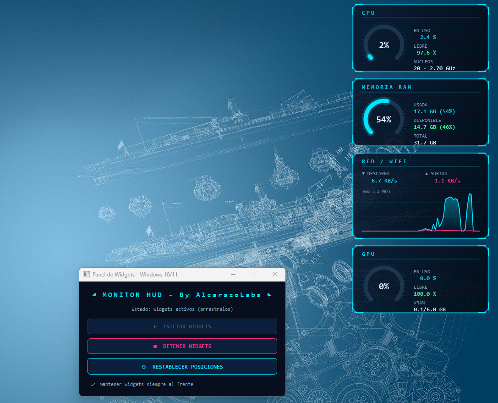
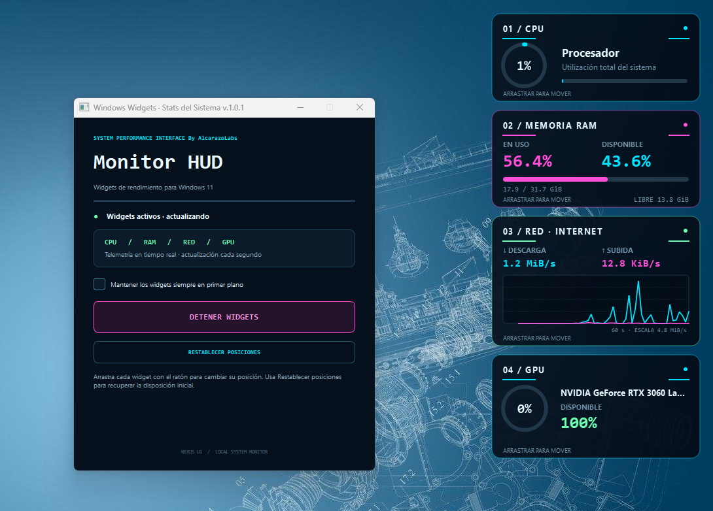

# 🛰️ Widgets Futuristas de Monitoreo para Windows 11

Aplicación en **Python** que muestra en el escritorio de Windows 11 un conjunto de **widgets con estilo futurista (HUD)** para monitorear en tiempo real el rendimiento del equipo: **CPU, memoria RAM, red/WiFi y GPU**.

Los widgets se inician y se detienen con un botón desde un panel de control, y cada uno puede **arrastrarse con el mouse** para colocarlo donde quieras.

* v.1.0.0 Preview: 

* v.1.0.1 Preview: 

---

## 🎯 ¿Para qué sirve?

Sirve para tener siempre a la vista, directamente sobre el escritorio, el estado de los recursos más importantes de tu computadora, con una apariencia tecnológica y futurista:

- Saber cuánto CPU está consumiendo tu equipo.
- Ver cuánta memoria RAM está en uso y cuánta hay disponible.
- Observar el consumo de ancho de banda de internet/WiFi en una gráfica en vivo.
- Conocer el porcentaje de uso de la GPU (usado y disponible).

Es útil para gamers, desarrolladores, creadores de contenido o cualquier persona que quiera monitorear su PC sin abrir el Administrador de tareas.

---

## ✨ Características

- **Panel de control** con botones para **Iniciar** y **Detener** los widgets.
- **4 widgets independientes** con estilo futurista:
  - CPU
  - Memoria RAM
  - Red / WiFi (gráfica en tiempo real)
  - GPU
- **Widgets arrastrables:** haz clic izquierdo sobre cualquiera y muévelo a la posición que prefieras.
- **Posición inicial por defecto:** los cuatro aparecen **alineados verticalmente, uno debajo de otro, en la esquina superior derecha** de la pantalla.
- **Botón "Restablecer posiciones"** para devolverlos a la esquina superior derecha.
- **Opción "Mantener siempre al frente"** para que los widgets queden por encima de otras ventanas (activada por defecto).
- **Actualización en tiempo real** cada 1 segundo.
- **Colores dinámicos:** el medidor cambia de color según la carga
  - 🔵 Cian: carga baja (< 60 %)
  - 🟠 Ámbar: carga media (60 % – 85 %)
  - 🔴 Rojo: carga alta (> 85 %)
- **Estilo visual HUD:** fondo oscuro translúcido, bordes con brillo neón, esquinas tipo interfaz de ciencia ficción y líneas de escaneo sutiles.
- **Sin bordes ni icono en la barra de tareas:** los widgets se integran al escritorio.
- **Compatible con GPU NVIDIA, AMD e Intel.**
- **Cierre limpio:** al cerrar el panel de control se detienen todos los widgets y se libera la aplicación.

---

## 💻 Requisitos

| Requisito | Detalle |
|---|---|
| Sistema operativo | Windows 11 (también funciona en Windows 10) |

## ▶️ Descarga y Ejecución

* <a target="_blank" href="https://www.mediafire.com/file/jmqzg9pazzs6qmy/widgets-w10-11-v1.0.0.exe/file"> Descargar v.1.0.0 </a>

* <a target="_blank" href="https://www.mediafire.com/file/f29t72sielzxgje/widgets-w10-11-v1.0.1.exe/file"> Descargar v.1.0.1 </a>

Descarga el ejecutable y solo dale doble click y se apertura la ventana para iniciar los widgets:

---

## 🖱️ Uso

1. Ejecuta la aplicación: aparecerá el **panel de control** *MONITOR HUD*.
2. Pulsa **▶ INICIAR WIDGETS**: los cuatro widgets aparecerán en la esquina superior derecha, uno debajo de otro.
3. **Arrastra** cualquier widget con el clic izquierdo para cambiar su posición.
4. Pulsa **⟲ RESTABLECER POSICIONES** para devolverlos a su lugar original.
5. Usa la casilla **"Mantener widgets siempre al frente"** para activar o desactivar que queden sobre otras ventanas.
6. Pulsa **■ DETENER WIDGETS** para ocultarlos y detener el monitoreo.
7. Al cerrar el panel de control se cierra toda la aplicación.

### Botones del panel de control

| Botón | Función |
|---|---|
| ▶ INICIAR WIDGETS | Crea y muestra los widgets en el escritorio y comienza el monitoreo. |
| ■ DETENER WIDGETS | Cierra los widgets y detiene la lectura de datos. |
| ⟲ RESTABLECER POSICIONES | Los coloca de nuevo en la esquina superior derecha, en vertical. |
| ☑ Mantener siempre al frente | Alterna si los widgets quedan por encima de otras ventanas. |

---

## 📊 Descripción de los widgets

### 1. CPU
Medidor circular con el porcentaje de uso del procesador.
- **En uso:** porcentaje de CPU consumido.
- **Libre:** porcentaje disponible.
- **Núcleos:** cantidad de núcleos lógicos y frecuencia actual (GHz).

### 2. Memoria RAM
Medidor circular con el porcentaje de memoria en uso.
- **Usada:** GB usados y porcentaje.
- **Disponible:** GB libres y porcentaje.
- **Total:** memoria RAM total instalada.

### 3. Red / WiFi
Gráfica en tiempo real (últimos 60 segundos) del consumo de ancho de banda.
- **▼ Descarga** (línea cian con área sombreada).
- **▲ Subida** (línea magenta).
- Velocidades actuales con unidades automáticas (B/s, KB/s, MB/s, GB/s).
- Escala vertical automática según el tráfico.

### 4. GPU
Medidor circular con el porcentaje de uso de la GPU.
- **En uso:** porcentaje de GPU consumido.
- **Libre:** porcentaje disponible.
- **VRAM:** memoria de video usada/total (solo en GPU NVIDIA).

---

## 🎮 Cómo se obtiene el uso de la GPU

La aplicación detecta automáticamente el método disponible:

1. **GPU NVIDIA** → usa **NVML** (`nvidia-ml-py`). Entrega uso de la GPU y memoria VRAM con alta precisión.
2. **GPU AMD / Intel** (o si NVML no está disponible) → consulta los **contadores de rendimiento de Windows** (WMI) mediante PowerShell en un hilo en segundo plano (motor 3D). Muestra el porcentaje de uso; no incluye VRAM.

---
## 🛠️ Solución de problemas

| Problema | Solución |
|---|---|
| La GPU siempre muestra 0 % | Si es NVIDIA, instala `nvidia-ml-py` y actualiza los drivers. Si es AMD/Intel, verifica que PowerShell funcione y que los drivers de la GPU estén actualizados. |
| El uso de GPU tarda en aparecer (AMD/Intel) | Es normal: la consulta por PowerShell se actualiza cada ~1.5 segundos. |
| Los widgets quedan detrás de otras ventanas | Activa la casilla **"Mantener widgets siempre al frente"**. |
| Un widget se perdió fuera de pantalla | Pulsa **Restablecer posiciones**. |
| Gráfica de red en 0 | Verifica que haya tráfico activo de red; la app suma todas las interfaces (WiFi/Ethernet). |

---

## 📄 Licencia

Proyecto de uso libre. Puedes modificarlo y adaptarlo a tus necesidades.
By Alcarazolabs | AlcLabs | @surflaweb
